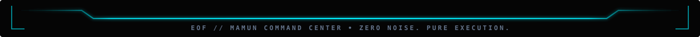

<div align="center">
  
</div>

<br />

<div align="center">
  <a href="https://git.io/typing-svg">
    
  </a>
</div>

<br />

### `root@mamun:~#`

```yaml
USER    : Mamun
CLASS   : Backend, Game-Server & Web Developer
ARSENAL : Pawn (SA-MP / open.mp) | Python | Web | Node.js | MySQL
MINDSET : "I don't just write code. I build systems that dominate."
STATUS  : Grinding in silence. Shipping in public.
```

<br />

### `⚡ TECH ARSENAL`

<div align="center">
  
  
  
  
  
  
  <br />
  
  
  
  
  
</div>

<br />

### `⚡ SYSTEM TELEMETRY`

<div align="center">
  
</div>

<br />

<div align="center">
  
  
</div>

<br />

<div align="center">
  
</div>

<br />

<div align="center">
  
</div>

<br />

<div align="center">
  
</div>

<br />

### `⚡ CONNECT`

<div align="center">
  <a href="https://github.com/mdmamun116600-bot">
    
  </a>
  <a href="https://discord.com/users/1492613676467748978">
    
  </a>
  <a href="mailto: mdmamun116600@gmail.com">
    
  </a>
</div>

<br />

<div align="center">
  
</div>
